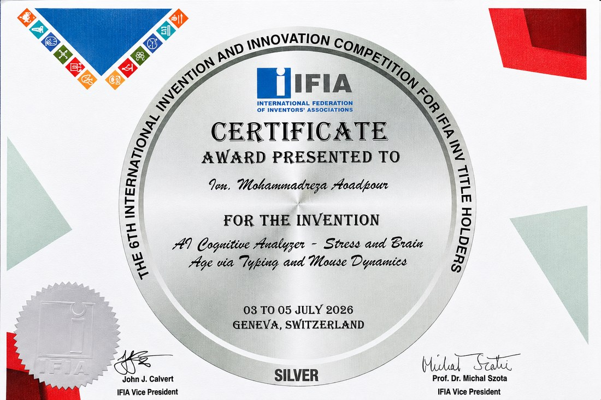
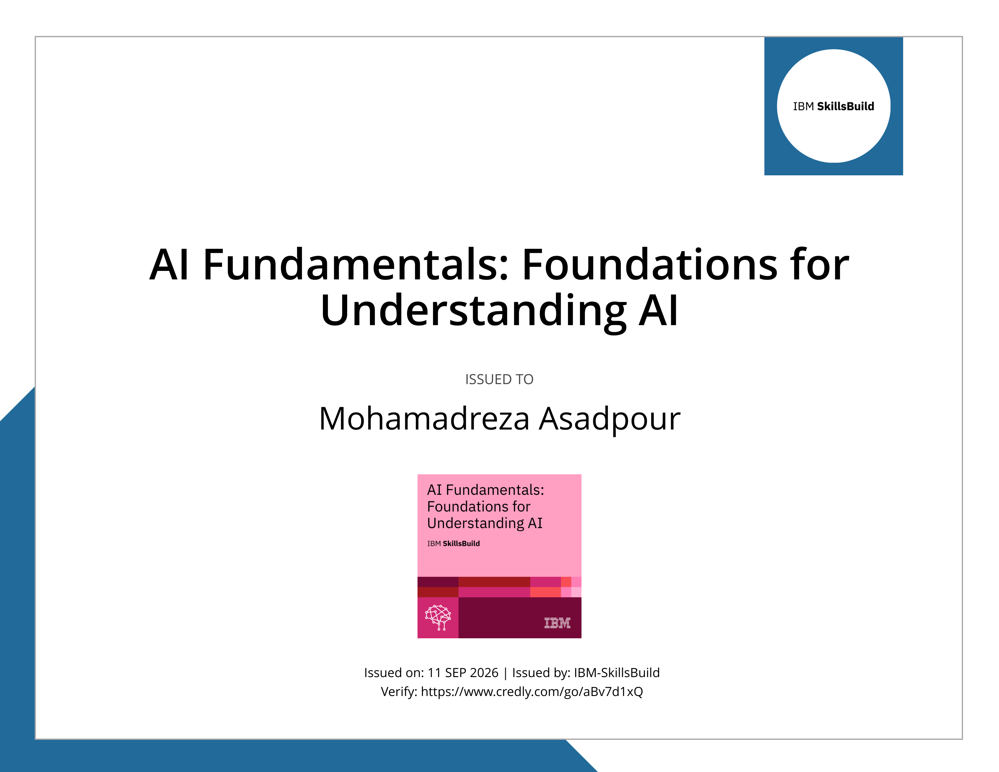
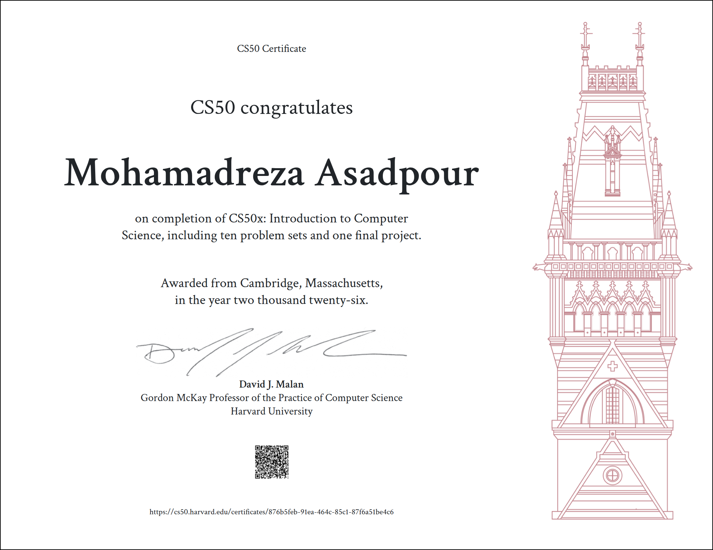

<!-- 🌌 COLORFUL PROFILE HEADER -->

  
  
  
  

## 👨‍💻 About Me

Hello! I'm **Mohammadreza Asadpour**, an AI Engineer and Full-Stack Developer passionate about building intelligent systems and modern digital experiences.

- 🤖 Interested in Artificial Intelligence, Machine Learning, and Deep Learning.
- 🧠 Exploring Computer Vision, neural networks, LLMs, RAG, and AI agents.
- 🌐 Developing web applications and full-stack projects.
- 🏆 Silver Medalist at the 6th International Invention & Innovation Competition in Geneva, Switzerland, in 2026.
- 📚 Continuously learning through technical courses, hands-on projects, and research.
- 🚀 Focused on turning creative ideas into practical, real-world solutions.

**My goal:** Combine AI, software engineering, and creativity to build technology that makes a difference.

---

## 🌈 Tech Stack & Skills

### 💻 Programming Languages

  
  
  
  
  

### 🤖 Artificial Intelligence & Machine Learning

  
  
  
  

  
  
  
  
  
  

### 🌐 Web Development

  
  
  
  

### 🗄️ Databases

  
  

### 🛠️ Tools & Design

  
  
  
  
  

---

## 🏆 Achievements & Recognition

### 🥈 International Silver Medal — Geneva, Switzerland

**6th International Invention & Innovation Competition — Geneva 2026**

Awarded a Silver Medal for the innovation:

**AI Cognitive Analyzer — Stress and Brain Age via Typing and Mouse Dynamics**

📍 Geneva, Switzerland · July 3–5, 2026

 

### 🌍 IFIA Recognition

**IFIA — International Federation of Inventors' Associations**

Recognized as an IFIA inventor member.

---

## 🎓 Certificates & Courses

### 🤖 IBM — AI Fundamentals

**AI Fundamentals**

Learning in Artificial Intelligence through IBM's AI fundamentals course.

 

### 🎓 Harvard University — CS50x

**CS50's Introduction to Computer Science**

An introduction to computer science and programming through Harvard's CS50x course.

---

## 📊 GitHub Statistics

 

---

## 🐍 Contribution Activity

---

## 📫 Let's Connect!

I'm always interested in AI projects, software development, creative ideas, and opportunities to learn and collaborate.

  

**💡 Code. Create. Innovate. Repeat.**

